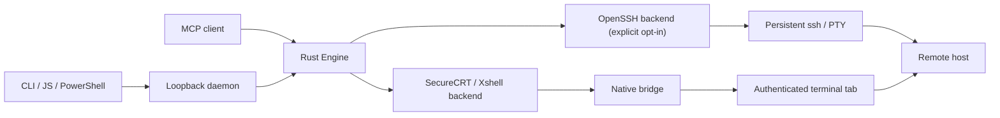

# securecrt-mcp

[简体中文](README.md) · [English](README.en.md) · [Documentation map](docs/README.en.md)

Let your AI assistant work through SSH tabs you have already logged into. **securecrt-mcp** is a local Rust MCP server for Codex, Claude and other MCP clients, for people operating remote systems through **SecureCRT or Windows Xshell**.

[](https://github.com/seaworld008/securecrt-mcp/actions/workflows/ci.yml?query=branch%3Amain)
[](https://github.com/seaworld008/securecrt-mcp/releases/latest)
[](LICENSE)
[](Cargo.toml)

MCP lets an AI client call tools running on your computer. Desktop backends reuse the terminal's existing login, VPN, bastion and MFA context without exporting SSH credentials or opening another SSH connection. The optional **OpenSSH** backend opens its own connection with your system SSH client, agent, configuration and host keys.

- Discover tabs and bind an explicit target; reuse that attachment for commands or batches of up to 20 commands.
- Track state, actual POSIX exit codes, paginated output, timeouts and local audit records.
- Use OpenSSH exec / PTY streams for logs, pagers and REPLs. Desktop backends capture screens; they are not native PTYs.
- Keep client approvals and remote account permissions under your control. Unknown results require inspection; commands and idle recovery are never retried automatically.

## Architecture



The MCP client uses one long-lived Rust Engine to reuse authenticated desktop terminals; OpenSSH is an explicitly selected independent backend. The bridge handles native terminal calls and buffering, while Rust owns command state, boundaries, retained output and auditing.

## Choose a backend

| Backend | Best suited to | Connection and runtime |
| --- | --- | --- |
| SecureCRT / Windows | Inspection, diagnostics and batches in authenticated tabs | Installed SecureCRT, with the bundled JScript bridge loaded |
| Xshell / Windows | Commands and result capture in existing sessions | Installed Xshell, with the bundled JScript bridge; coverage follows actual discovery |
| SecureCRT / macOS | Reusing SecureCRT login and terminal context | Installed SecureCRT and a Python engine supported by its native loader |
| OpenSSH / Windows, macOS, Linux | Low-latency commands, continuous logs, pagers and REPLs | System OpenSSH; explicitly selected independent connection using SSH configuration, Agent and host keys |

Desktop backends suit existing authenticated terminals; OpenSSH suits native streams and lower latency. Use the capabilities returned by discovery. Tested systems, terminal versions and architectures are listed in the [support matrix](docs/support-matrix.md). Linux desktop SecureCRT has not passed native desktop acceptance.

## Quick start

### 1. Download and install

Download the package for your system and architecture from [GitHub Releases](https://github.com/seaworld008/securecrt-mcp/releases/latest), verify its accompanying `SHA256SUMS`, and extract the entire archive to a stable directory. The current version is **0.5.7**. Keep the executable, bridge and documentation from the same version.

Windows users can follow [Start here](START-HERE.en.md):

| Client | Installation entry | Next step |
| --- | --- | --- |
| Codex | `install.cmd`, or the binary's `install` command | Additive Codex configuration, then load the terminal bridge and reload MCP |
| Claude Code / Desktop, other MCP clients | `initialize-only.cmd`, or the binary's `init` command | Register the absolute executable path, `serve` argument and application home as documented for your client |

`install` copies the executable into a private user directory and updates Codex's `securecrt` entry, preserving other settings and existing approvals, tool restrictions, tokens and policy. `init` initializes this tool only. Other clients connect over stdio. See [Codex](docs/clients/codex.en.md), [Claude Code / Desktop](docs/clients/claude.en.md) and [installation and upgrade](docs/installation.en.md).

The default application home is `%USERPROFILE%\.securecrt-mcp` on Windows or `~/.securecrt-mcp` on macOS/Linux. `SECURECRT_MCP_HOME` can select an absolute path; the terminal bridge and MCP client must use the same home. A running terminal does not inherit later environment changes. Follow the [installation guide](docs/installation.en.md) when using a custom home.

### 2. Load the terminal bridge

Log into your server in the terminal. Once the authorized test tab is idle, use the terminal's menu to load the entry shown by `paths`:

| Platform / backend | Menu | Bridge entry |
| --- | --- | --- |
| Windows / SecureCRT | Script → Run | `securecrt-mcp-securecrt.js` |
| Windows / Xshell | Tools → Script → Run Script | `securecrt-mcp-xshell.js` |
| macOS / SecureCRT | Script → Run | `securecrt_bridge.py` |

Windows bundles include `show-paths.cmd` for actual paths. Load the script inside the terminal rather than double-clicking `.js` in a file manager. SecureCRT needs one script per process; Xshell coverage follows actual discovery. Keep the terminal and bridge running, then reload your AI client's MCP connection. The client starts `serve`, so a separate server window is usually unnecessary. Skip this step for OpenSSH.

### 3. Check and verify

Use the bundled `check-securecrt.cmd` or `check-xshell.cmd`, or run the diagnostic commands below. Here, `securecrt-mcp` means the selected executable; on Windows use the actual path to `securecrt-mcp.exe`.

```sh
securecrt-mcp --version
securecrt-mcp paths
securecrt-mcp doctor --offline
securecrt-mcp doctor --backend securecrt
securecrt-mcp doctor --backend xshell
securecrt-mcp doctor --backend openssh
```

Run online checks only for backends you use. In your AI client, discover with `connector_list`, bind explicitly with `connector_open`, and inspect desktop context with `connector_read_screen`. After verifying an authorized idle POSIX test tab, execute one harmless `printf` and check output, `state`, `sent` and `exit_code`. Configuration, bridge discovery and real execution are separate validation layers; see [desktop acceptance](docs/desktop-acceptance.md).

### Ask an Agent to install

Paste this into an AI client with local tools. The full procedure is in [Agent setup prompts](docs/agent-setup.md#english-prompt).

```text
Install https://github.com/seaworld008/securecrt-mcp for my AI client.
Read its current docs/agent-setup.md and docs/installation.en.md first.
Identify my OS, architecture and terminal; verify the source and checksum.
Preserve existing MCP entries, approvals, policies, tokens and SSH logins.
Use my client's documented setup route and run doctor --offline.
Load the bridge when authorized; hand off any unavailable native UI steps.
Test harmlessly only in an explicitly authorized idle tab; never assume idle.
Report passed, failed and untested layers; config checks are not SSH proof.
```

## Daily use

All public tools use the `connector_*` namespace. Discover and bind an explicit target, then reuse its returned `session_id`. A tab name or index is not an attachment handle. Keep one MCP connection for task state, output pagination and operation receipts.

| Task | Main tools | Usage |
| --- | --- | --- |
| Discover and bind | `connector_list`, `connector_open` | Verify backend, target and authorization; rediscover and rebind after reconnection |
| Inspect desktop context | `connector_read_screen` | Read the current prompt; optionally limit returned history |
| Execute a command | `connector_exec` | POSIX mode returns actual exit code, state and capture evidence |
| Run a batch | `connector_exec_batch`, `connector_get_batch_status` | Up to 20 sequential commands; uncertainty or timeout stops later entries |
| Read output pages | `connector_read` | Read retained output without resending the command |
| Continuous interaction | `connector_stream_open`, `connector_stream_read`, `connector_stream_write` | OpenSSH PTY; raw input remains subject to client approval |
| Diagnose and release | `connector_metrics`, `connector_heartbeat`, `connector_close` | Inspect state, maintain attachments and release tool sessions |

Desktop binding example, replacing the target with this discovery's returned ID:

```json
{"backend":"securecrt","target":"opaque-target-from-current-list","mode":"exec"}
```

OpenSSH can use an existing SSH Host alias:

```json
{"backend":"openssh","target":"my-ssh-host-alias","mode":"exec"}
```

Execute only after verifying authorization, prompt and idle state. Handle password prompts, menus, editors, database sessions and pagers according to their actual interaction mode. See the [Agent workflow](docs/agent-usage.en.md) for commands, batches, logging and script transfer, and the [interface contract](docs/connectors.md) for parameters and states.

### Running and uncertain results

`starting` / `running` means query the original task. `completed` and its actual `exit_code` establish foreground completion. For timeout, cancellation or `unknown`, inspect the original session and retained output, then obtain explicit operator confirmation of recovery conditions. Operation IDs are deduplicated within one MCP process, without permanent deduplication across restarts.

`connector_interrupt`, `connector_acknowledge` and Windows `connector_restore_prompt` require the relevant explicit authorization and context checks. Recovery does not automatically send Ctrl+C, replay a command or switch backends. Foreground completion does not prove that every background descendant terminated. Follow the recovery steps in the [Agent workflow](docs/agent-usage.en.md).

## Performance and output capture

OpenSSH command sessions reuse one persistent SSH process, avoiding per-command handshakes. Desktop latency depends on native SDK reads, log flushing and script-thread scheduling. Measure each backend separately.

| Path | 100 warm short commands, p50 / p95 | Suggested use |
| --- | --- | --- |
| MCP / Windows OpenSSH | 12 ms / 16 ms | Low-latency commands and native streams |
| SecureCRT / native logging | 180 ms / 225 ms | Existing login with large-output capture |
| Xshell / session logging | 646 ms / 1,072 ms | Diagnostics in existing Xshell sessions |

These measurements come from the Windows native regression campaign and exclude initial authentication. See the [regression and performance report](docs/acceptance/windows-mac-regression-2026-10-14.md) for conditions and comparison scope; they are not guarantees across systems or networks.

Windows desktop commands and batches can explicitly set `prefer_native_log=true` to capture temporary native logs from the same authenticated session and reduce per-line SDK calls. This defaults off and temporarily writes command echo and output into a private directory; do not enable it for commands containing secrets. Existing user logging stays unchanged. Encoding and log-format requirements are documented in the [capture guide](docs/agent-usage.en.md).

SecureCRT's default `ReadString` path still has concurrency constraints when long output and another tab's timeout recovery share one native thread. Prefer native logging for long concurrent diagnostics, or OpenSSH for native SSH latency. Results expose incomplete capture, truncation and cursor gaps. See the [regression report](docs/acceptance/windows-mac-regression-2026-10-14.md) for limits and retained failed evidence, and [performance](docs/performance.md) for measurement methods.

## Stop, upgrade and troubleshoot

Windows **0.5.7** bridges support normal stop. Confirm there are no active or unresolved commands, open `stop-securecrt.cmd` or `stop-xshell.cmd`, select the intended instance and confirm; enter `0` to cancel. The bridge exits naturally while preserving SSH logins, avoiding SecureCRT's native forced-cancellation `Script Cancelled` notice. The CLI equivalent is `securecrt-mcp stop-native-host --backend securecrt --choose --confirmed-idle`; use `--backend xshell` for Xshell.

For upgrades, finish or inspect existing work, normally stop the bridge and stop the MCP client, install the matching complete package, load the fixed terminal entry, then reload the client and check. Older bridges without normal stop need one idle cancellation through the native menu; in SecureCRT, return to the original launching tab. Updating files does not reload a running script. Ordinary upgrades retain tokens and policy; do not use `init --force`.

| Symptom | Next step |
| --- | --- |
| Bridge offline / target tab absent | Load the correct entry inside the authenticated terminal; check application home, connection and actual discovery scope |
| Diagnostics pass but client tools are absent | Reload MCP and check client configuration location and existing tool restrictions |
| `unknown_apis` or incomplete support tier | Read the reasons; rerun diagnostics after authorized harmless verification. Resolve missing APIs or identity mismatches first |
| Invalid attachment / prompt mismatch | Inspect the original tab; rebind after reconnection or context changes instead of guessing a same-name replacement |
| Missing output / timeout | Read the original task, inspect capture fields and terminal state, then follow explicit recovery |

See [troubleshooting](docs/troubleshooting.md) and [installation and upgrade](docs/installation.en.md). Include versions, system, backend, error codes and sanitized reproduction steps in reports. Keep tokens, credentials, server addresses and prior terminal history private.

## Security, development and contributing

The tool runs locally. Remote operations are constrained by SSH account permissions, MCP client approvals and local policy. Desktop backends reuse existing login; OpenSSH follows system configuration and host-key verification. Local audit records provide operation and dispatch evidence. Read the [security model](docs/security-model.md) and [support policy](docs/support-policy.md) before deployment. Report vulnerabilities privately under [SECURITY.md](SECURITY.md).

Source builds need Rust 1.88+ and a platform linker. Node 22 is used for tests and packaging; Mac native contract tests use Python. Build from matching source and documentation:

```sh
git clone --branch main https://github.com/seaworld008/securecrt-mcp.git
cd securecrt-mcp
git rev-parse HEAD
cargo build --release --locked
```

Executables are in `target/release`. Verify the commit's [CI results](https://github.com/seaworld008/securecrt-mcp/actions/workflows/ci.yml?query=branch%3Amain). CI test bundles and public releases have their own checksum files. Historical versions follow their accompanying documentation; keep binaries and bridges matched.

Development: [Contributing](CONTRIBUTING.md) · [Agent maintenance](docs/agent-maintenance.md) · [Testing](docs/testing.md) · [Desktop acceptance](docs/desktop-acceptance.md). Automated tests, native desktop behavior, SSH execution and client approvals require separate evidence.

More documentation: [Documentation map](docs/README.en.md) · [Architecture](docs/architecture.md) · [Interface contract](docs/connectors.md). Submit feature requests and sanitized issues to [GitHub Issues](https://github.com/seaworld008/securecrt-mcp/issues). Licensed under the [MIT License](LICENSE).
