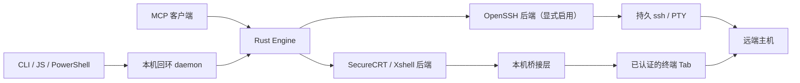

# securecrt-mcp

[简体中文](README.md) · [English](README.en.md) · [文档地图](docs/README.md)

让 AI 助手通过你已经登录的 SSH Tab 工作。**securecrt-mcp** 是本机 Rust MCP Server，面向通过 **SecureCRT 或 Xshell** 管理远端系统的用户，可接入 Codex、Claude 等 MCP 客户端。

[](https://github.com/seaworld008/securecrt-mcp/actions/workflows/ci.yml?query=branch%3Amain)
[](https://github.com/seaworld008/securecrt-mcp/releases/latest)
[](LICENSE)
[](Cargo.toml)

MCP 让 AI 客户端调用你电脑上的本机工具。桌面后端沿用终端已有的登录、VPN、堡垒机与 MFA 上下文，不导出 SSH 凭据、不另建 SSH 连接。可选 **OpenSSH** 后端会另建连接，使用系统 SSH 客户端、SSH Agent、配置和主机密钥。

- 发现 Tab、显式绑定目标，同一附件可连续执行命令或最多 20 条的批量任务。
- 跟踪命令状态、真实 POSIX 退出码、分页输出、超时和本地审计记录。
- OpenSSH 提供 exec / PTY 流，适合日志、分页器和 REPL；桌面后端捕获屏幕，并非原生 PTY。
- 客户端审批和远端账号权限由操作者掌握；结果未知时先检查，不自动重发命令或确认空闲。

## 架构



MCP 客户端通过一个长生命周期 Rust Engine 复用已认证的桌面终端；OpenSSH 是显式启用的独立后端。桥接层只负责原生终端调用和缓冲，命令状态、边界、输出保留与审计由 Rust 管理。

## 选择适合的后端

| 后端 | 适合的工作 | 连接与运行要求 |
| --- | --- | --- |
| SecureCRT / Windows | 沿用已登录 Tab 的巡检、诊断和批量命令 | 已安装 SecureCRT，加载包内 JScript 桥接 |
| Xshell / Windows | 在已登录会话中执行命令、采集结果 | 已安装 Xshell，加载包内 JScript 桥接；以实际发现的会话为准 |
| SecureCRT / macOS | 沿用 SecureCRT 的登录和终端上下文 | 已安装 SecureCRT，使用其支持的 Python 引擎加载原生桥接 |
| OpenSSH / Windows、macOS、Linux | 低延迟命令、持续日志、分页器与 REPL | 系统 OpenSSH；显式选择独立 SSH 连接，使用现有 SSH 配置、Agent 与主机密钥 |

桌面后端适合复用现有登录；OpenSSH 适合需要原生流和更低延迟的任务。具体工具能力以发现结果为准。已验证的系统、终端版本和架构见[支持矩阵](docs/support-matrix.md)；Linux 桌面 SecureCRT 尚未纳入真机验收。

## 快速开始

### 1. 下载并安装

从 [GitHub Releases](https://github.com/seaworld008/securecrt-mcp/releases/latest) 下载对应系统与架构的包，核对随附 `SHA256SUMS`，完整解压到稳定目录。当前版本为 **0.5.7**；二进制、桥接和文档应来自同一版本。

Windows 用户可直接按[从这里开始](START-HERE.md)操作：

| 使用方式 | 安装入口 | 下一步 |
| --- | --- | --- |
| Codex | `install.cmd`，或二进制的 `install` 命令 | 自动增量配置 Codex，随后加载终端桥接并重载 MCP |
| Claude Code / Desktop、其他 MCP 客户端 | `initialize-only.cmd`，或二进制的 `init` 命令 | 按客户端文档注册二进制绝对路径、`serve` 参数及应用目录 |

`install` 将二进制安装到用户私有目录并更新 Codex 的 `securecrt` 条目，保留其他配置与已有审批、工具限制、令牌和策略。`init` 只初始化本工具。其他客户端通过 stdio 接入；详细配置见 [Codex](docs/clients/codex.md)、[Claude Code / Desktop](docs/clients/claude.md)和[安装与升级](docs/installation.md)。

默认应用目录为 Windows 的 `%USERPROFILE%\.securecrt-mcp` 或 macOS/Linux 的 `~/.securecrt-mcp`。`SECURECRT_MCP_HOME` 可指定绝对路径；终端桥接与 MCP 客户端须使用同一目录。已有终端进程不会继承后来设置的环境变量，自定义目录请按[安装说明](docs/installation.md)配置。

### 2. 加载终端桥接

先在终端登录目标服务器，确认获准使用的测试 Tab 已空闲，再通过终端菜单加载 `paths` 显示的入口：

| 平台 / 后端 | 菜单 | 桥接入口 |
| --- | --- | --- |
| Windows / SecureCRT | Script → Run | `securecrt-mcp-securecrt.js` |
| Windows / Xshell | Tools → Script → Run Script | `securecrt-mcp-xshell.js` |
| macOS / SecureCRT | Script → Run | `securecrt_bridge.py` |

Windows 包内的 `show-paths.cmd` 可显示准确路径。脚本须在终端内部加载；不要在文件管理器中双击 `.js`。SecureCRT 每个进程加载一次；Xshell 以实际发现范围为准。保持终端和桥接运行，然后重载 AI 客户端的 MCP 连接。客户端负责启动 `serve`，通常无需另开服务窗口。OpenSSH 后端跳过这一步。

### 3. 检查并验证

可使用包内 `check-securecrt.cmd`、`check-xshell.cmd`，或执行以下诊断命令。示例中的 `securecrt-mcp` 指所选二进制；Windows 使用 `securecrt-mcp.exe` 的实际路径。

```sh
securecrt-mcp --version
securecrt-mcp paths
securecrt-mcp doctor --offline
securecrt-mcp doctor --backend securecrt
securecrt-mcp doctor --backend xshell
securecrt-mcp doctor --backend openssh
```

仅运行使用中的后端检查。诊断通过后，在 AI 客户端中用 `connector_list` 发现目标、`connector_open` 显式绑定、`connector_read_screen` 检查桌面上下文；确认已授权且空闲的 POSIX 测试 Tab 后，执行一次无害 `printf` 并核对输出、`state`、`sent` 和 `exit_code`。配置检查、桥接发现和真实执行是不同的验证层，验收方法见[桌面验收](docs/desktop-acceptance.md)。

### 让 Agent 协助安装

复制以下提示词到具备本机工具的 AI 客户端；完整流程见 [Agent 安装提示词](docs/agent-setup.md)。

```text
请为我的 AI 客户端安装 https://github.com/seaworld008/securecrt-mcp。
先读官方当前 docs/agent-setup.md 和 docs/installation.md。
识别 OS、架构和终端，核对所选来源与摘要。
保留已有 MCP、审批、策略、令牌和 SSH 登录。
按对应客户端文档配置，并执行 doctor --offline。
获准后加载桥接；无法操作的原生 UI 步骤给我准确交接。
仅在明确授权的空闲 Tab 做无害验证，不自动判定空闲。
分别报告通过、失败和未测项，不把配置检查当作 SSH 执行证明。
```

## 日常使用

工具统一使用 `connector_*` 命名。先发现并绑定明确目标，后续调用复用返回的 `session_id`；Tab 名称或序号不能代替附件句柄。推荐保持一个 MCP 连接，以保留任务状态、输出分页和操作去重记录。

| 任务 | 主要工具 | 使用要点 |
| --- | --- | --- |
| 发现与绑定 | `connector_list`、`connector_open` | 核对后端、目标和权限；重连后重新发现并绑定 |
| 检查桌面上下文 | `connector_read_screen` | 读取当前提示符；可按需限制返回历史 |
| 执行命令 | `connector_exec` | POSIX 模式返回实际退出码、命令状态和输出证据 |
| 批量任务 | `connector_exec_batch`、`connector_get_batch_status` | 最多 20 条顺序执行；超时或结果未知会阻止后续条目 |
| 分页读取 | `connector_read` | 读取已保留输出，避免重发原命令 |
| 持续交互 | `connector_stream_open`、`connector_stream_read`、`connector_stream_write` | OpenSSH PTY；原始输入需按客户端权限审批 |
| 诊断与释放 | `connector_metrics`、`connector_heartbeat`、`connector_close` | 查看运行状态、维护附件、释放本工具会话 |

桌面 Tab 绑定示例（替换为本次发现返回的目标）：

```json
{"backend":"securecrt","target":"opaque-target-from-current-list","mode":"exec"}
```

OpenSSH 可绑定已有 SSH Host 别名：

```json
{"backend":"openssh","target":"my-ssh-host-alias","mode":"exec"}
```

只有在已确认授权、提示符和空闲状态后，才向绑定会话执行命令。密码提示、菜单、编辑器、数据库交互和分页器须按其真实交互模式处理。命令、批量、日志和脚本传输的完整示例见 [Agent 工作流](docs/agent-usage.md)；参数与状态契约见[接口文档](docs/connectors.md)。

### 处理运行中与不确定结果

`starting` / `running` 表示继续查询原任务；`completed` 与真实 `exit_code` 表示本次前台命令完成。超时、取消或 `unknown` 时，检查原会话与已保留输出，再由操作者明确确认恢复条件。操作 ID 在同一 MCP 进程内去重；重启后不提供永久去重保证。

`connector_interrupt`、`connector_acknowledge` 和 Windows 的 `connector_restore_prompt` 均需要相应的显式授权与上下文校验。恢复不会自动发送 Ctrl+C、重放命令或切换后端；前台命令结束也不能证明所有后台子进程已终止。恢复步骤见 [Agent 工作流](docs/agent-usage.md)。

## 性能与输出捕获

OpenSSH 命令会话复用一个持久 SSH 进程，避免逐条握手。桌面桥接受终端 SDK 的读取、日志刷新和原生脚本线程调度约束，性能应按实际后端分别评估。

| 路径 | 100 条热连接短命令 p50 / p95 | 建议用途 |
| --- | --- | --- |
| MCP / Windows OpenSSH | 12 ms / 16 ms | 低延迟命令和原生流 |
| SecureCRT / 原生日志 | 180 ms / 225 ms | 保留已有登录并捕获大量输出 |
| Xshell / 会话日志 | 646 ms / 1,072 ms | 保留已有 Xshell 会话的诊断任务 |

以上为同一轮 Windows 真机测试的实测值，不含首次登录；测试条件和比较范围见[回归与性能报告](docs/acceptance/windows-mac-regression-2026-10-14.md)，不代表所有系统和网络的保证值。

Windows 桌面命令及批量任务可显式设置 `prefer_native_log=true`，使用同一已认证会话的临时原生日志，减少逐行 SDK 调用。此选项默认关闭，会将命令回显和输出临时写入私有目录；包含秘密的命令不应启用。既有用户日志保持原状，编码与日志格式要求见[捕获说明](docs/agent-usage.md)。

SecureCRT 默认 `ReadString` 路径在同一原生线程上混合长输出与其他 Tab 的超时恢复时仍有并发限制；长输出并行诊断优先选原生日志，追求原生 SSH 延迟时选 OpenSSH。捕获不完整、截断和分页缺口均通过结果字段呈现。测试边界与保留的失败证据见[回归报告](docs/acceptance/windows-mac-regression-2026-10-14.md)，测量方法见[性能说明](docs/performance.md)。

## 停止、升级与排障

Windows **0.5.7** 桥接支持正常停止。确认无运行中或结果未明的命令后，打开 `stop-securecrt.cmd` 或 `stop-xshell.cmd`，选择明确实例并确认；输入 `0` 可取消。桥接自然退出并保留 SSH 登录，可避免 SecureCRT 原生强制取消的 `Script Cancelled` 提示。命令行等价入口为 `securecrt-mcp stop-native-host --backend securecrt --choose --confirmed-idle`；Xshell 使用 `--backend xshell`。

升级时，先完成或核实已有任务，正常停止桥接并停止 MCP 客户端，安装同版本整包，再在终端加载固定入口、重载客户端并检查。旧桥接不支持正常停止时，须在空闲状态通过终端菜单取消一次；SecureCRT 回到最初启动脚本的 Tab 操作。仅更新磁盘文件不会重载脚本。常规升级保留令牌和策略，不使用 `init --force`。

| 现象 | 下一步 |
| --- | --- |
| 桥接未运行 / 找不到目标 Tab | 在已登录终端加载正确脚本，检查应用目录、连接状态和实际发现范围 |
| 诊断成功但客户端无工具 | 重载 MCP，核对客户端配置位置与已有工具限制 |
| `unknown_apis` 或非完整支持等级 | 阅读具体原因；完成获准的无害验证后再诊断，缺失 API 或身份不符需先解决 |
| 附件失效、提示符不匹配 | 检查原 Tab；重连或上下文改变后重新绑定，避免按名称猜测替代目标 |
| 输出缺失或超时 | 读取原任务、检查捕获字段和终端状态，按明确恢复流程处理 |

更多问题见[排障](docs/troubleshooting.md)与[安装升级说明](docs/installation.md)。报告问题时提供版本、系统、后端、错误码和脱敏复现步骤；令牌、凭据、服务器地址及既有终端历史应留在本地。

## 安全、开发与贡献

本工具在本机执行，远端操作受 SSH 账号权限、MCP 客户端审批和本地策略共同约束。桌面后端复用已有登录；OpenSSH 遵循系统配置与主机密钥校验。本地审计用于检查操作与发送证据。部署前阅读[安全模型](docs/security-model.md)和[支持策略](docs/support-policy.md)；漏洞按 [SECURITY.md](SECURITY.md)私下报告。

源码构建需要 Rust 1.88+ 与平台链接器；Node 22 用于测试和打包，Mac 原生契约测试使用 Python。使用匹配的源码与文档构建：

```sh
git clone --branch main https://github.com/seaworld008/securecrt-mcp.git
cd securecrt-mcp
git rev-parse HEAD
cargo build --release --locked
```

产物位于 `target/release`。核对该提交的 [CI 结果](https://github.com/seaworld008/securecrt-mcp/actions/workflows/ci.yml?query=branch%3Amain)；CI 测试包与公开 Release 分别使用各自的校验文件。历史版本要求以其配套文档为准，避免混用新旧二进制与桥接。

开发入口：[贡献指南](CONTRIBUTING.md) · [Agent 维护导航](docs/agent-maintenance.md) · [开发测试](docs/testing.md) · [桌面验收](docs/desktop-acceptance.md)。自动测试、原生桌面、SSH 执行和客户端审批分别记录证据。

更多文档：[文档地图](docs/README.md) · [架构设计](docs/architecture.md) · [接口契约](docs/connectors.md)。功能建议与脱敏问题提交至 [GitHub Issues](https://github.com/seaworld008/securecrt-mcp/issues)。项目采用 [MIT License](LICENSE)。
